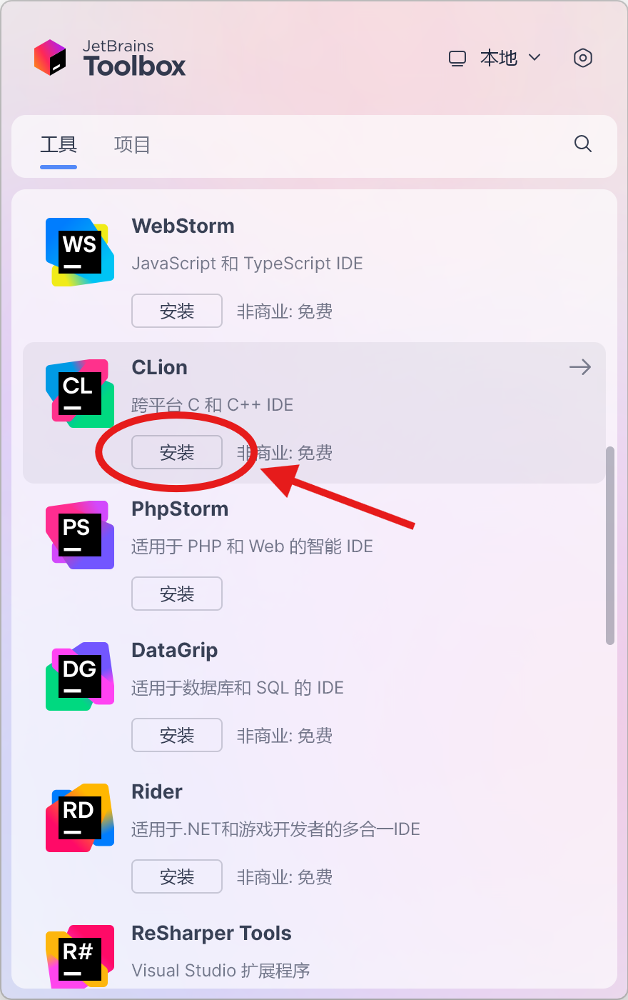
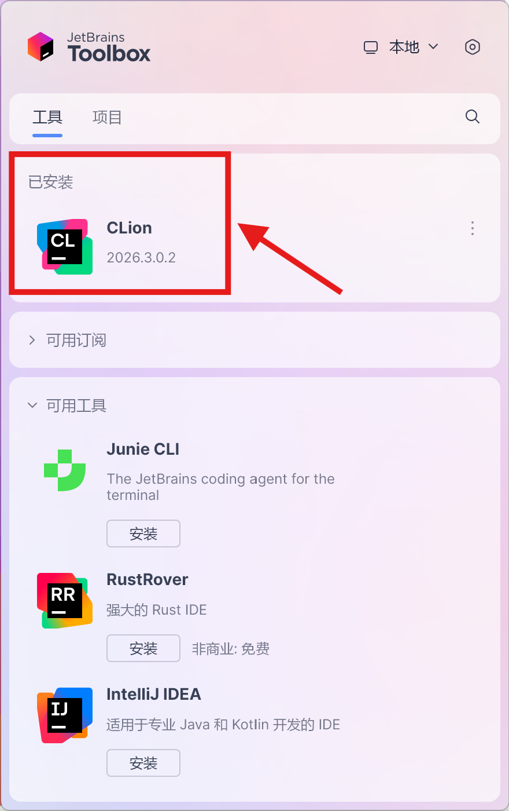
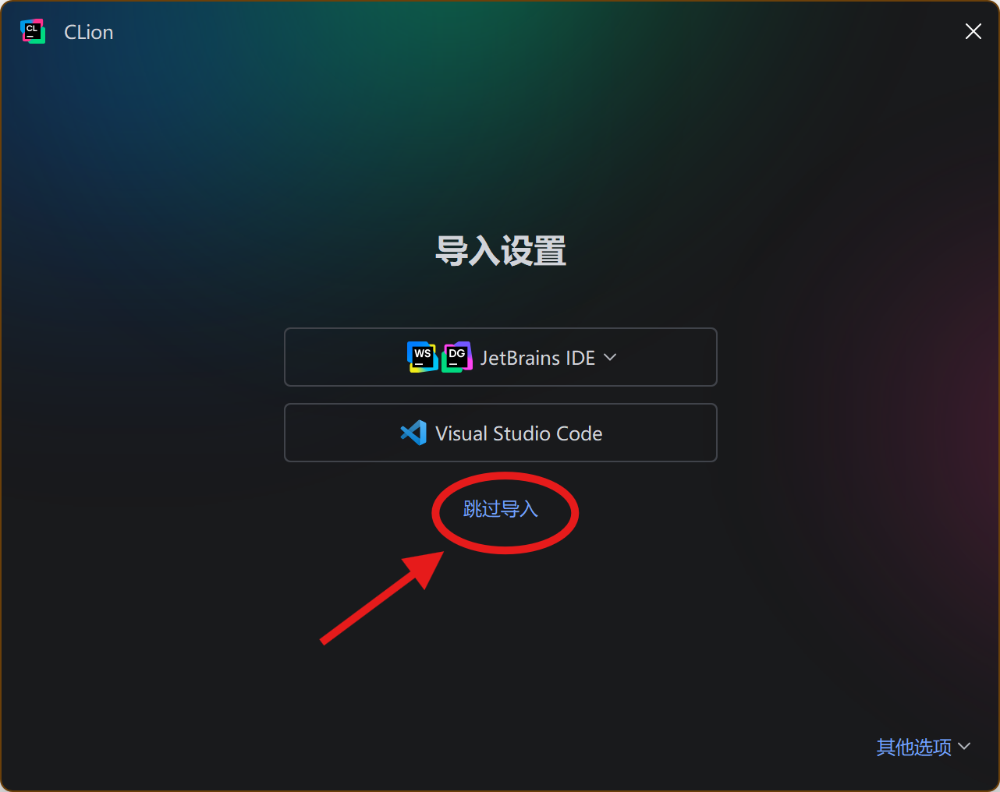
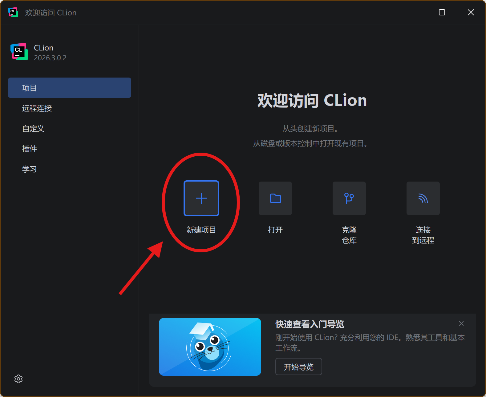
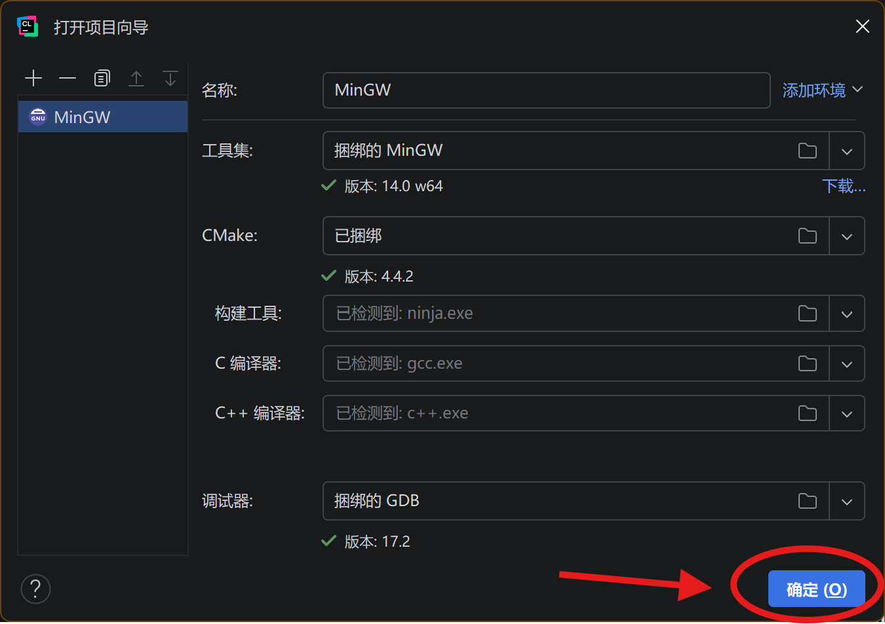
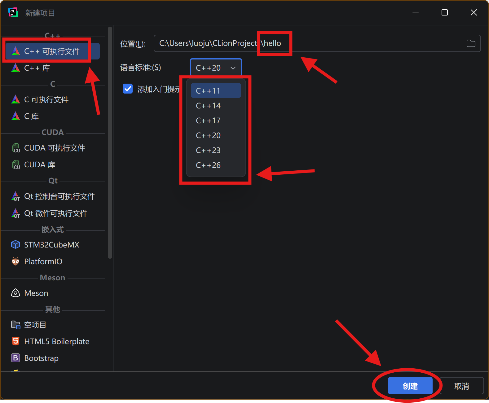
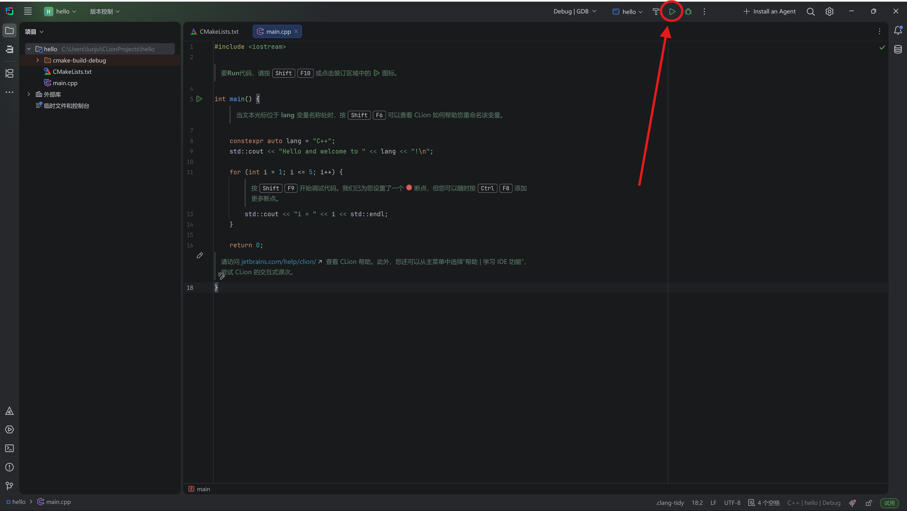
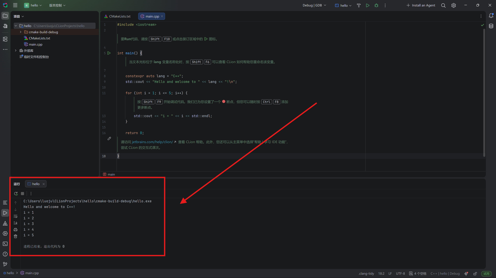

# 安装 Clion

搜索（推荐使用Bing国际版）“jetbrains toolbox”

等待下载&安装

安装完成，点击启动

跳过导入

新建项目

首次启动时弹出编译环境选项对话框，默认全部正常，点击确定

配置项目参数，其中语言标准按需选择，平时训练可尝试最新版本

首次启动项目时弹出编译环境选项对话框，默认全部正常，点击确定

默认已打开main.cpp文件，点击右上角图标按钮运行

查看控制台输出
